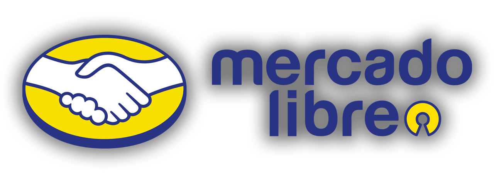

<h1 align="center">
    Open Source at Mercado Libre
</h1>

    <strong>Guide to Mercado Libre’s open source approach, InnerSource model, and Open Source Program Office (OSPO).</strong>

    <a href="#what-is-open-source-for-us">What is Open Source for us?</a> •
    <a href="#our-approach">Our approach</a> •
    <a href="#open-source-program-office-ospo">Open Source Program Office (OSPO)</a>
     
    <a href="#conclusion">Conclusion</a> •
    <a href="#related-resources">Related resources</a> •
    <a href="#license">License</a>

    
    
    

## What is Open Source for us?

$`Open\ Source = Legal\ framework + Method\ of\ production + Social\ arrangement.`$

In terms of technology, Open Source is the best way to create software because it speeds up product feedback, drives adoption, and improves the reliability of the product that we are building. From the business side, business innovation leads to larger communities spurring more tech innovation and that leads to increased incentives for Open Source, closing a virtuous cycle.

## Our approach

At [Mercado Libre](https://news.mercadolibre.com/en/acercade), we believe that Open Source is essential for technological progress and building a strong developer community. Our objectives are to:

- **Adopt**: Integrate open source technologies into our projects and products whenever possible to enhance efficiency and reduce costs.
- **Collaborate**: Work together with open source communities to improve software quality, share knowledge, and foster innovations.

### InnerSource model

We have implemented an InnerSource model to foster collaboration and knowledge sharing across teams. InnerSource allows us to apply Open Source principles within our organization, enabling teams to contribute to each other's projects, share best practices, and improve overall software quality.

> For more information about our InnerSource model, please read our [dedicated article](https://medium.com/mercadolibre-tech/transforming-software-development-at-mercado-libre-with-innersource-016b35e1ded3).

## Open Source Program Office (OSPO)

The Open Source Program Office (OSPO) at [Mercado Libre](https://news.mercadolibre.com/en/acercade) is responsible for managing our Open Source initiatives. Our OSPO focuses on:

- **Promoting**: Encouraging the conscious use to Open Source projects within our organization.
- **Managing**: Overseeing the policies and practices related to Open Source to ensure we follow industry best practices.
- **Supporting**: Assisting teams wishing to make contributions to Open Source projects or develop new ones.

> [!NOTE]
> For queries and collaborations, get in touch with our OSPO team at [ospo@mercadolibre.com](mailto:ospo@mercadolibre.com).

## Conclusion

At [Mercado Libre](https://news.mercadolibre.com/en/acercade), we value Open Source as a pillar of innovation and collaboration.

## Related resources

- [Linux Foundation](https://www.linuxfoundation.org/)
- [Mercado Libre's APIs for developers](https://developers.mercadolibre.com)
- [Mercado Libre's technology blog](https://medium.com/mercadolibre-tech)
- [Open Chain](https://openchainproject.org/)
- [OSPO Alliance](https://ospo-alliance.org/)
- [TODO Group](https://todogroup.org/)

## License

This repository is under the [Creative Commons Attribution 4.0 International license](LICENSE.md).
